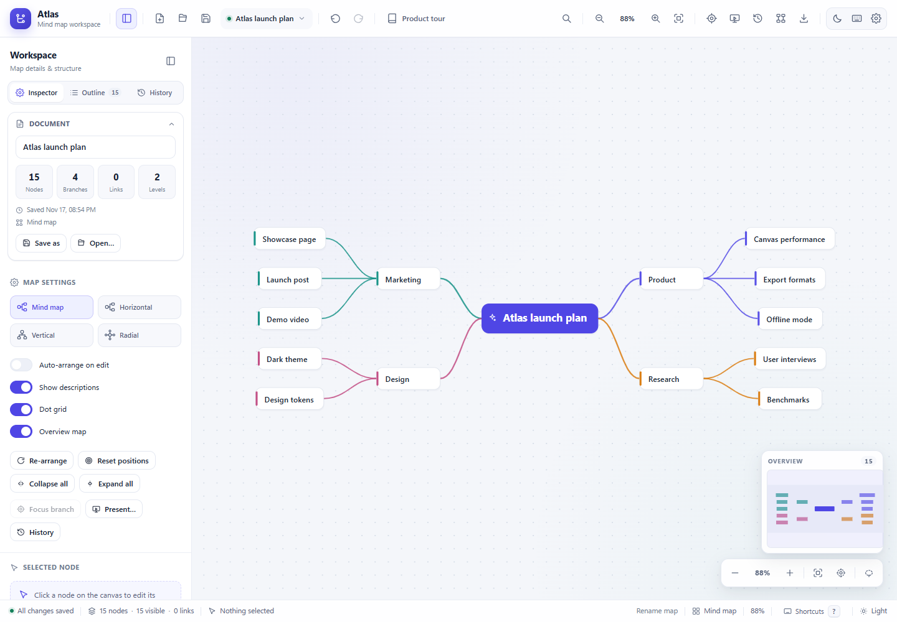
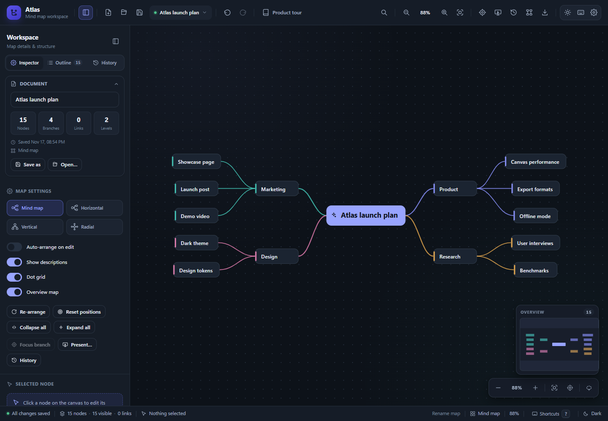
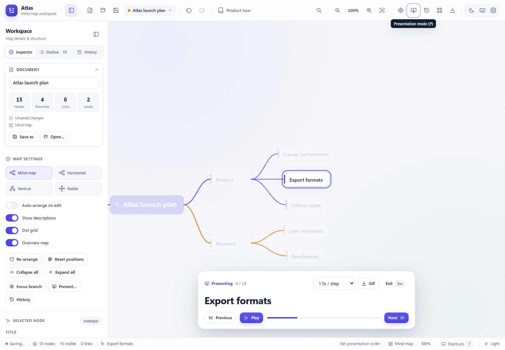
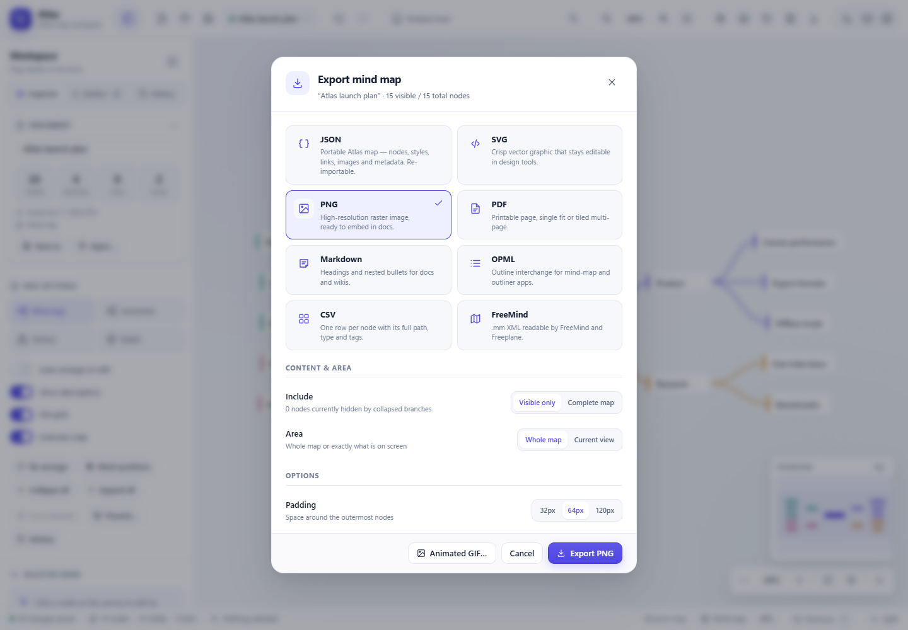
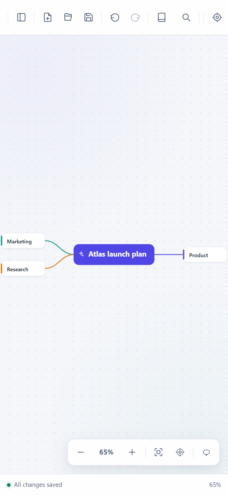

<div align="center">


# Atlas

### A local-first mind-map workspace that never phones home

Think in branches, keep notes, images and checklists on every node, and export the result as
JSON, SVG, PNG, PDF, GIF, Markdown, OPML, CSV or FreeMind. It all runs in a browser tab, with
no account, no server and no upload.

[**Quickstart**](#quickstart) · [**Features**](#features) · [**Workflows**](#step-by-step-workflows) · [**FAQ**](#faq) · [**License**](#license)

<br>

[](package.json) [](tsconfig.json) [](vite.config.ts) [](public/manifest.webmanifest) [](#data-and-privacy)

[](package.json) [](package.json) [](#performance) [](package.json) [](LICENSE)

</div>

<br>

<div align="center">
  
  <br>
  <sub>Four layouts, a full inspector per node, focus mode, presentation mode and a minimap. One document, no sign-in.</sub>
</div>

<br>

---

## Why Atlas

Most mind-map tools are a canvas bolted to a subscription. Atlas is a document editor that happens
to draw maps, and it is honest about where your data lives: in your browser, in your control.

<table>
<tr>
<td width="50%" valign="top">
<h3>Local-first, genuinely</h3>
<p>IndexedDB persistence, a service worker that precaches the app shell, and a CSP that only allows
same-origin connections. Close the laptop on a plane and keep working.</p>
<p><a href="#6--install-it-and-work-offline"><strong>Offline details →</strong></a></p>
</td>
<td width="50%" valign="top">
<h3>A real workspace, not a canvas</h3>
<p>Every node carries a Markdown note, tags, a checklist, links, code, LaTeX and images, plus
version history, undo/redo, search and multi-tab write protection.</p>
<p><a href="#features"><strong>Feature list →</strong></a></p>
</td>
</tr>
<tr>
<td width="50%" valign="top">
<h3>Exports that match the canvas</h3>
<p>One shared measurement and appearance layer feeds both the canvas and the export renderer, so an
SVG or PDF is not a lookalike of your map. It is the same geometry.</p>
<p><a href="#architecture"><strong>Architecture →</strong></a></p>
</td>
<td width="50%" valign="top">
<h3>Documents you can keep</h3>
<p>Auto-save, named snapshots, whole-library backup with per-map checksums, and a portable
<code>atlas-map</code> JSON that moves maps between browsers with images intact.</p>
<p><a href="#data-and-privacy"><strong>Data safety →</strong></a></p>
</td>
</tr>
</table>

<br>

## Features

| Area | What you get |
| --- | --- |
| **Layout** | Four automatic layouts: balanced mind map, horizontal tree, vertical tree, radial. Hand-drag any node; **Re-arrange** snaps everything back. |
| **Editing** | Double-click to rename inline, double-click empty canvas to add a node, `Tab`/`Enter` for child and sibling. Full undo/redo for every change. |
| **Selection** | Right-drag a marquee to select many nodes, Shift to extend. Corner-drag to resize; the opposite corner stays put and the drag is one undo step. |
| **Content** | Per node: Markdown note, tags, checklist, links, code blocks, LaTeX formulas and images. Badges on the node show what it carries. |
| **Images** | Chosen from your device, downscaled, stored as blobs in IndexedDB. Opaque → JPEG, transparent → WebP/PNG. Never fetched from a URL. |
| **Styling** | Style presets, per-node colour, font size and weight, corner radius, fixed width/height, and **Reset to auto size**. |
| **Navigation** | Focus Mode dims everything outside one branch, collapse/expand, fit-to-screen, minimap, ranked full-text search with field filters. |
| **Presentation** | Presentation Mode with autoplay, speed control and a custom step order. |
| **Export** | JSON (re-importable), SVG, PNG, PDF, **animated GIF**, Markdown, OPML, CSV, FreeMind. |
| **Portability** | `atlas-map` JSON wrapper with version, checksum and embedded images; whole-library backup and restore. |
| **Offline** | Installable PWA, versioned shell cache, atomic updates with an **Update available → Reload** banner. |
| **Safety** | Auto-save, named snapshots, multi-tab revision guard, storage-quota warnings, unused-image cleanup. |

### Exports at a glance

| Format | Best for | Images |
| --- | --- | --- |
| **JSON** (`atlas-map`) | re-importing, moving between browsers | preserved |
| **SVG** · **PNG** · **PDF** | docs, slides, print | node thumbnails included |
| **Animated GIF** | a walkthrough you can drop in a chat or a PR | node thumbnails included |
| **Markdown** · **OPML** · **CSV** · **FreeMind** | outlines, spreadsheets, other tools | text only |

The animated GIF is built from the presentation steps: one frame per step, palette-quantised and
encoded locally with `gifenc`, with a frame and pixel budget so a long deck cannot exhaust memory.
It is one export among nine, not the point of the app.

<br>

## Screenshots

<div align="center">

| Light | Dark |
| --- | --- |
|  |  |

| Presentation Mode | Export dialog |
| --- | --- |
|  |  |

</div>

<div align="center">
  
  <br>
  <sub>390 px: the sidebar becomes a drawer and the status bar keeps only save state and zoom.</sub>
</div>

<br>

## Quickstart

Requires **Node 20.19+ or 22.12+** (Vite 7) and **npm 10+**.

```bash
git clone https://github.com/YOUR_GITHUB_USERNAME/atlas.git
cd atlas
npm install
npm run dev          # http://127.0.0.1:5173
```

Production build and preview:

```bash
npm run build        # tsc -b, then vite build → dist/
npm run preview      # http://127.0.0.1:4173
```

> `dist/index.html` **must be served over HTTP**. Opening it through `file://` fails because browsers
> block ES modules from file origins. Use `npm run preview` or any static server.

`dist/` is a plain static folder you can host anywhere. There is nothing else to configure:
no database, no API key, no environment variable, no sign-in.

<br>

## Step-by-step workflows

### 1 · Your first map in two minutes

1. Open the app. The empty state offers **Create Blank Map**, templates, import and the tour.
2. Click **Create Blank Map** to get a central topic.
3. With the root selected, press `Tab` to add a child, type a title, press `Enter`.
4. Press `Enter` again for a sibling. `Tab` nests one level deeper.
5. Press `F` to fit the map to the window. The status bar confirms **All changes saved**.

Auto-save fires ~900 ms after your last edit; `Ctrl/Cmd + S` writes immediately.

### 2 · Shape the tree and fill it in

1. Pick a layout in **Map settings**: balanced, horizontal, vertical or radial.
2. Drag a node to nudge it, or turn on **Auto-arrange on edit** to keep the layout live.
3. **Re-arrange** in the sidebar resets every hand-placed position.
4. Select several nodes by right-dragging a marquee; hold `Shift` to add to the selection.
5. Select a node and open **Inspector** to add a Markdown note, tags, a checklist, links, code,
   a LaTeX formula or an image.

### 3 · Present it

1. Press `P` (or **Presentation mode** in the toolbar).
2. Reorder the steps if you want a different storyline, then **Start presenting**.
3. Step through with `→` / `←`, adjust the speed, or hit **Play** for autoplay.

### 4 · Export it

1. `Ctrl/Cmd + E` opens **Export**.
2. Choose the format: **SVG** for design tools, **PNG** for docs, **PDF** for print, **JSON** to
   re-import, or **Animated GIF…** for a walkthrough built from the presentation steps.
3. Pick **Complete map** or **Current view**, and a padding preset, then export.

Rendered formats include node image thumbnails; Markdown, OPML, CSV and FreeMind are text outlines
and deliberately do not include images.

### 5 · Back up and move to another device

1. **Settings → Download backup** writes every saved map to one JSON file, with a format version
   and per-map checksums.
2. On the other device, **Settings → Restore…** imports them as copies.
3. For a single map, use **Export → JSON**, which embeds images and re-imports through **Import**.
4. Restore validates every checksum and rejects corrupted files with a clear message.

### 6 · Install it and work offline

1. Load the app once while online so the service worker can precache the shell.
2. Install it from the address bar (Chrome/Edge) or **Add to Home Screen** from the browser
   menu (Safari).
3. Enable offline mode in DevTools and hard-reload: the shell and your last map still open.

<br>

## Keyboard shortcuts

| Keys | Action |
| --- | --- |
| `Tab` (focused node) / `Insert` | Add a child |
| `Enter` | Add a sibling |
| `F2` | Edit the selected node |
| `Delete` | Delete the selected branch |
| `C` | Collapse / expand the branch |
| `Ctrl/Cmd + Z` · `Ctrl/Cmd + Shift + Z` | Undo · redo |
| `Ctrl/Cmd + C` · `V` · `D` | Copy · paste · duplicate |
| `Ctrl/Cmd + F` | Search |
| `Ctrl/Cmd + S` | Save |
| `Ctrl/Cmd + E` | Export |
| `Ctrl/Cmd + Shift + I` | Import |
| `F` · `Shift + F` | Fit to screen · focus the selected branch |
| `P` | Presentation mode |
| `?` | Full shortcut list |

Sidebar and rich-content tabs support arrow keys, `Home` and `End`.

<br>

## Configuration

### Map settings (per document)

| Setting | Values | Default |
| --- | --- | --- |
| Layout | Mind map · Horizontal · Vertical · Radial | Mind map |
| Auto-arrange on edit | on / off | off |
| Show descriptions | on / off | on |
| Dot grid | on / off | on |
| Overview map | on / off | on |
| Node size | width / height override, or auto | auto |

### App settings

Theme (light/dark), storage usage with 75 % and 90 % warnings, **Clean unused images** (deletes only
blobs unreferenced by maps, versions and undo history), **Download backup** and **Restore…**.

### Environment variables

**None.** Atlas reads no environment variables at build time or runtime.

<br>

## Architecture

Three rules keep the codebase coherent:

1. **One document model.** `src/core/mindmap/types.ts` is canonical. Every mutation is a command in
   `src/core/commands` committed to a single history stack, so undo/redo cannot drift from the document.
2. **One appearance layer.** `core/mindmap/appearance.ts` and `core/layout/measure.ts` define sizes and
   typography; `components/Canvas/NodeView.tsx` and `export/scene.ts` both consume them. The canvas and
   every rendered export stay identical because there is only one set of numbers.
3. **One writer.** `state/controller.ts` is the only place that replaces a document and the only place
   that persists one. All storage writes queue through `queueStorageWrite`.

```
src/
  core/          document model, commands, history, layout, measurement, codecs
  components/    canvas (SVG scene), sidebar, toolbar, dialogs, shared UI
  state/         store, actions, controller, derived data
  persistence/   IndexedDB repositories, versions, image blobs/GC, cross-tab sync
  pwa/           service-worker registration, update banner, build template
  export/        scene renderer + JSON/SVG/PNG/PDF/GIF/backup writers
  showcase/      product page and the Atlas hero demo
  stageshow/     the UI kit the demo is built from
  styles/        design tokens and component styles
e2e/             Playwright journeys
scripts/         benchmarks, smoke test, screenshot generator
```

`state/derivedData.ts` is pure and incremental: renaming a node re-measures that node and recomputes
bounds instead of re-scanning the map.

<br>

## Performance

Offline harness, 11-run median, Node 22. Full table and methodology in [BENCHMARKS.md](BENCHMARKS.md).

| Nodes | Layout | Validate | Search | SVG scene | Typing (derived) |
| ---: | ---: | ---: | ---: | ---: | ---: |
| 100 | 0.8 ms | 0.7 ms | 1.2 ms | 6.2 ms | 0.1 ms |
| 1,000 | 7.6 ms | 5.9 ms | 8.8 ms | 35.7 ms | 2.0 ms |
| 5,000 | 29.8 ms | 31.6 ms | 24.4 ms | 112.5 ms | 9.1 ms |

Layout stays close to linear, the canvas only renders nodes intersecting the viewport, and an edit
costs ~9 ms of derived work at 5,000 nodes. Production bundle: **283 kB main + 200 kB shared chunk
(≈148 kB gzipped)**, plus a lazily loaded showcase page.

<br>

## Development

```bash
npm run typecheck        # tsc -b --pretty false
npm test                 # Vitest: 141 tests across 23 files
npm run test:e2e         # 25 Playwright journeys (starts the dev server)
npm run test:pwa         # 2 production-build offline/update journeys
npm run bench            # regenerate the offline table in BENCHMARKS.md
npm run bench:browser    # Chromium render/typing/drag measurements
npm run screenshots      # regenerate docs/screenshots from a running preview
```

Playwright uses the bundled Chromium when installed and falls back to system Chrome. Force a channel
with `PLAYWRIGHT_CHANNEL=chrome|msedge|bundled`.

CI ([`.github/workflows/ci.yml`](.github/workflows/ci.yml)) runs typecheck → unit tests → build →
benchmarks → Playwright on every push and pull request.

<br>

## Data and privacy

- **No account, no server, no cloud sync.** Nothing leaves the browser: imports, exports and GIF
  encoding all run client-side.
- **Storage:** documents and version snapshots live in IndexedDB (`atlas-mindmaps`) under the current
  origin, with a localStorage fallback (~5 MB) when IndexedDB is blocked.
- **The service worker caches the app shell only**, never maps, images or history.
- **Images are local files.** There are no external image URLs or remote image fetches anywhere in
  the app; the CSP allows `img-src 'self' data: blob:` only.
- **Export images:** JSON and the whole-library backup preserve uploaded images; SVG, PNG, PDF and
  animated GIF include the node thumbnail rendered from the local image data. Markdown, OPML, CSV and
  FreeMind are text outlines and do
  **not** include images.
- **Per browser, per origin.** A different device or domain will not see the same maps. Clearing site
  data deletes them, so keep a backup.
- **Multi-tab safety:** a save publishes a revision; a tab with a newer revision blocks a stale write
  and offers *Save my copy*, *Reload theirs* or *Overwrite*, keeping a snapshot first.

Security posture, the dependency audit and the CSP rationale are documented in
**[SECURITY.md](SECURITY.md)**.

<br>

## FAQ

<details>
<summary><b>Where is my data actually stored?</b></summary>

In IndexedDB in your own browser profile, keyed by the deployment origin. There is no account and no
server copy. Clearing site data, using private mode, or switching browsers will not carry your maps
across. Use **Export → JSON** or **Settings → Download backup**.
</details>

<details>
<summary><b>Does anything get uploaded?</b></summary>

No. There is no analytics, no telemetry and no network call after the app shell loads. The
Content-Security-Policy pins `connect-src` to the same origin (plus WebSocket transport, for the dev
server's hot reload), so a rogue request could not leave the page even if one were introduced.
</details>

<details>
<summary><b>Does it work offline?</b></summary>

Yes, after one successful online visit so the service worker can precache the shell. Editing, saving,
importing, exporting, GIF generation and a hard reload all work offline.
</details>

<details>
<summary><b>What happens if I open the same map in two tabs?</b></summary>

The second save is blocked by a revision check. You get a warning offering *Save my copy*, *Reload
theirs* or *Overwrite*, and a named snapshot is kept before anything is replaced.
</details>

<details>
<summary><b>Why doesn't <code>dist/index.html</code> open by double-clicking?</b></summary>

Browsers refuse to load ES modules from `file://` origins. Serve the folder over HTTP:
`npm run preview` or any static server.
</details>

<details>
<summary><b>Do I need Node to use the app?</b></summary>

No. Node is only for building from source. The built site is static HTML/CSS/JS, and the installed
PWA works without a toolchain.
</details>

<br>

## Known limitations

- The service worker caches the app shell only; documents and images stay in IndexedDB and need one
  online visit to precache.
- Text inside exported GIFs uses system fonts, because an SVG rasterised as an image cannot load
  web fonts.
- No cloud sync; use the backup file to move maps between devices.
- Derived data still copies `byParent` and rebuilds bounds on every edit: O(n), ~9 ms at 5,000 nodes.

<br>

## Contributing

1. Fork, then `npm install`.
2. Make the change and run `npm run typecheck && npm test`.
3. For anything visual, add or update a Playwright journey in `e2e/`.
4. Keep the three architecture rules intact: one document model, one appearance layer, one writer.
5. Open a pull request; CI runs the full gate.

New node fields belong in `types.ts` + `validation.ts` + `migrations.ts` together, and a new persisted
store means bumping `DB_VERSION`.

<br>

## License

[MIT](LICENSE) © 2026 kunal.

<br>

<div align="center">
  <sub>
    Built with Vite, React, TypeScript and a hand-written SVG scene graph.<br>
    No analytics. No accounts. No uploads. Your maps stay where you made them.
  </sub>
</div>
